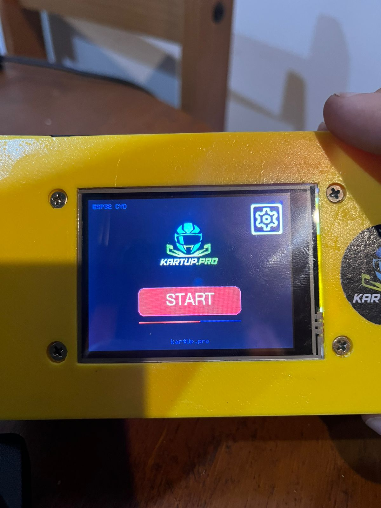
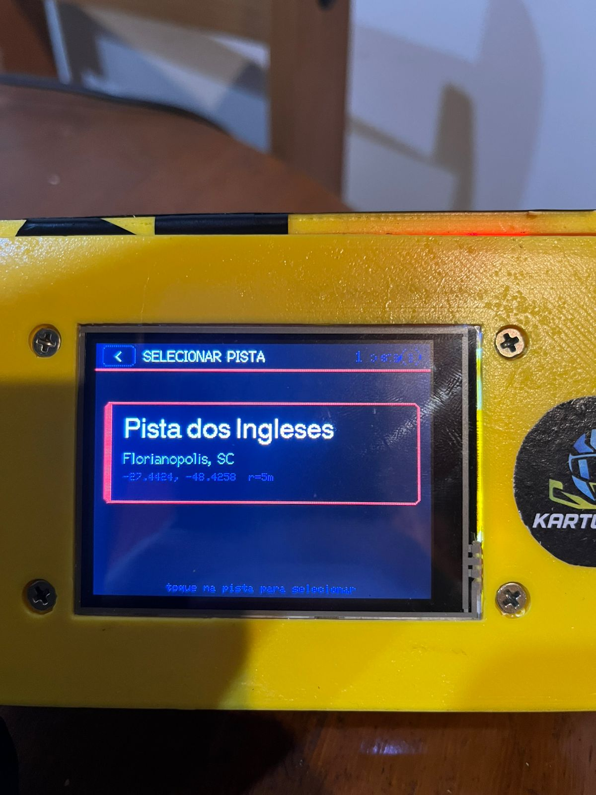
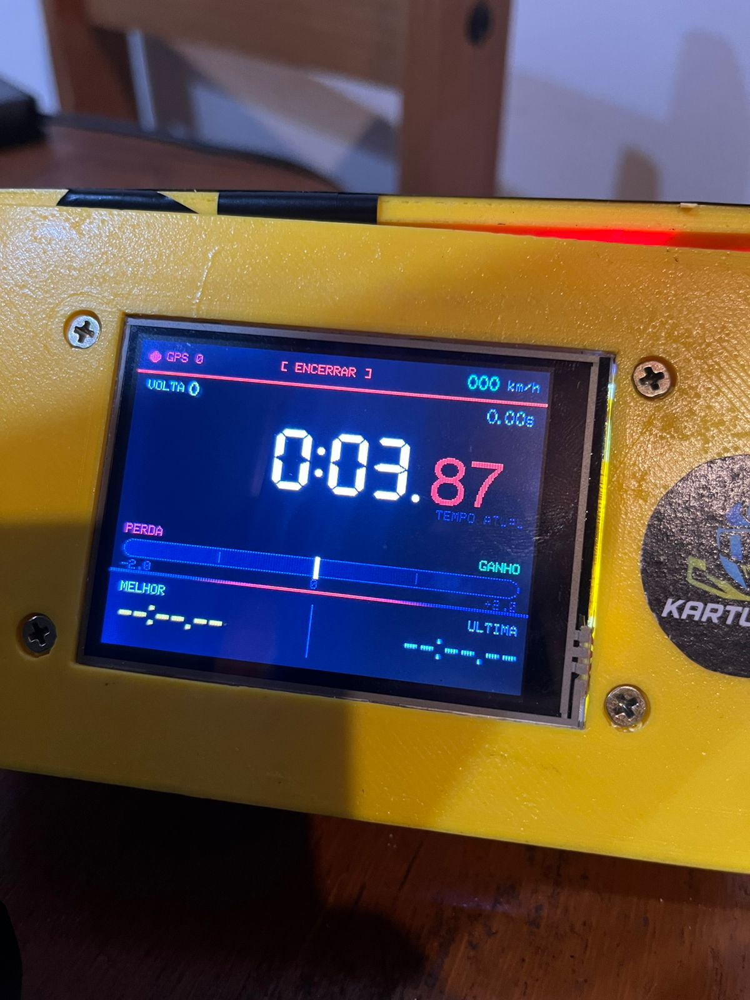
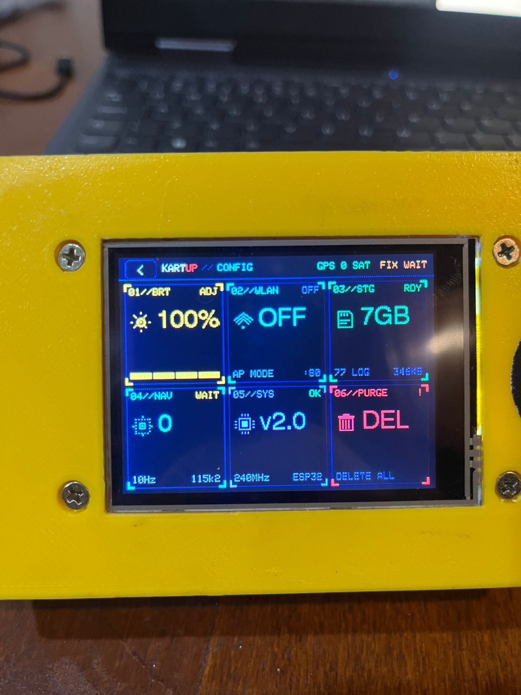

# KartUp — Lap Timer & Telemetria de Kart

<p align="center">
  
</p>

<p align="center">
  <b>Cronômetro de voltas e logger GPS para kartismo amador</b><br/>
  <sub>ESP32-CYD · ILI9341 320×240 · NEO-M8N @ 10Hz · SD logging · WiFi AP</sub>
</p>

<p align="center">
  
  
  
  
</p>

---

## Sobre

KartUp é um **lap timer com telemetria GPS** rodando em hardware barato (ESP32 CYD, ~R$80). Substitui equivalentes comerciais de R$1.500+ (AiM Mychron, Alfano, etc.) com:

- Cronometragem automática via **GPS de 10 Hz** (linha de chegada por coordenadas)
- Display **F1 Dark Cockpit** mostrando tempo atual, melhor volta, última, delta e velocidade
- Logging **10 Hz** em CSV no cartão SD (lat, lon, velocidade, volta, delta, timestamp)
- **WiFi AP integrado** para baixar arquivos CSV direto no celular sem cabo
- Suporte a múltiplas pistas (coordenadas + raio configurável)
- Interface 100% touch — sem botões físicos exceto power

Construído para usar **no kart de verdade**: filtro de média móvel na velocidade pra suavizar ruído da antena GPS, cache anti-flickering pra UI a 20 FPS sem memória de sprite, animação de borda roxa pulsante ao bater recorde pessoal.

---

## Galeria

<table>
  <tr>
    <td align="center" width="50%">
      <br/>
      <sub><b>Tela inicial</b><br/>Logo, botão START e acesso a configurações</sub>
    </td>
    <td align="center" width="50%">
      <br/>
      <sub><b>Seleção de pista</b><br/>Cards com nome, localização, coordenadas e raio da linha de chegada</sub>
    </td>
  </tr>
  <tr>
    <td align="center" width="50%">
      <br/>
      <sub><b>Logging ativo</b><br/>Tempo atual em Font 7, barra de delta, melhor/última volta e velocidade</sub>
    </td>
    <td align="center" width="50%">
      <br/>
      <sub><b>Settings — Tactical HUD</b><br/>Grid 3×2 com brilho, WiFi AP, SD info, GPS, sistema e purge</sub>
    </td>
  </tr>
</table>

---

## Hardware

| Componente | Modelo | Função |
|-----------|--------|--------|
| MCU + Display | **ESP32-2432S028R (CYD)** | Cheap Yellow Display, ILI9341 320×240 touch, ESP32 dual-core 240MHz, 4MB flash |
| GPS | **u-blox NEO-M8N** | 5 Hz, UART2 (RX=22, TX=27) a 115200 baud — **VCC alimentado direto pelo 5V do shield de bateria** (bypass do AMS1117 da CYD) |
| Armazenamento | Cartão **microSD** | SoftSPI (SCK=18, MISO=19, MOSI=23, CS=5) |
| Botão | **GPIO 0 (BOOT)** | Reset/programação |
| Power | Shield 18650 ou USB | 5V → AMS1117 → 3.3V |
| Case | **Impressão 3D PLA amarelo** | Design custom Kartup |

> **Aviso de hardware**: o AMS1117-3.3 da CYD é dimensionado no limite. Adicionar GPS + SD + WiFi AP simultâneo estressa o regulador (já queimou um nesta unidade — saída caiu para 2,75V).
>
> **Workaround aplicado**: VCC do NEO-M8N alimentado direto pelos 5V do shield de bateria, bypassando o AMS1117. O módulo M8N tem regulador onboard que aceita até 6V. Só TX/RX/GND continuam no conector CN1 da CYD.

---

## Stack de Software

- **Framework**: Arduino-ESP32 via PlatformIO
- **Display**: [TFT_eSPI](https://github.com/Bodmer/TFT_eSPI) 2.5.43 (sem sprite — desenho direto + cache anti-flicker)
- **GPS**: [TinyGPSPlus](https://github.com/mikalhart/TinyGPSPlus) 1.1.0
- **Touch**: [XPT2046_Touchscreen](https://github.com/PaulStoffregen/XPT2046_Touchscreen)
- **SD**: [SdFat](https://github.com/greiman/SdFat) 2.3.1 com driver SoftSPI
- **WiFi/HTTP**: Bibliotecas nativas do ESP32 Arduino
- **Fontes custom**: Bahnschrift VLW (`f1_time_font`, `f1_speed_font`), Font 7 (7-segmentos), Font 4/6 built-in

---

## Estrutura do Projeto

```
kartup.prolaptimer/
├── src/
│   ├── main.cpp              # firmware principal (interface + lógica de volta + WiFi)
│   ├── teste_gps.cpp         # env separado para diagnóstico GPS
│   ├── ucenter_bridge.cpp    # ponte UART para configurar GPS via u-center
│   ├── logo.h                # logo KartUp (RGB565 PROGMEM)
│   ├── settings_icon.h       # ícone engrenagem
│   ├── wifi_icon.h           # ícone WiFi
│   ├── f1_time_font.h        # fonte VLW para tempos de volta
│   └── f1_speed_font.h       # fonte VLW para velocidade
├── docs/
│   └── screenshots/          # capturas do dispositivo real
├── 3.LOGO/                   # arte e ícones fonte
├── platformio.ini            # configuração de build
├── CLAUDE.md                 # documentação técnica detalhada
├── convert_logo.py           # JPEG → RGB565 logo.h
└── README.md
```

---

## Build & Flash

### Pré-requisitos

- [PlatformIO Core](https://platformio.org/install/cli) (ou extensão VS Code)
- Driver USB-Serial da CYD (CH340 ou CP210x)
- Cabo USB-C de qualidade (alguns cabos só carregam, não enumeram dados)

### Compilar

```bash
pio run -e cyd
```

### Flashar (porta padrão COM3, 921600 baud)

```bash
pio run -e cyd -t upload
```

### Monitorar serial

```bash
pio device monitor -b 115200 --port COM3
```

### Environments disponíveis

| Env | Função |
|-----|--------|
| `cyd` | Firmware principal de produção |
| `teste_gps` | Diagnóstico isolado do GPS (UART2 → Serial) |
| `ucenter_bridge` | Ponte UART transparente para configurar NEO-M8N via u-center |
| `cyd_debug` | Build com flag `GPS_CSV_ONLY` para validação de fix |

---

## Como Usar

### 1. Boot
Plugue o shield de bateria. Tela inicial aparece com logo KartUp e botão **START**. Ícone de engrenagem no canto superior direito abre **Settings**.

### 2. Selecionar Pista
Toque um card de pista. Coordenadas e raio (em metros) definem a linha de chegada. Pistas são pré-cadastradas em `TRACKS[]` no `main.cpp`.

### 3. Iniciar Sessão
Na tela "pronta" toque **INICIAR LOG**. O sistema:
- Inicializa o cartão SD e cria `gps_NNN.csv` incremental
- Limpa estado de voltas (contador, melhor, última)
- Começa a aguardar fix do GPS

### 4. Andar
Cada vez que o kart cruza a linha de chegada (entra no raio em torno das coordenadas configuradas) → nova volta registrada. Display mostra:
- **Tempo atual** em 7-segmentos gigante
- **Delta** em segundos vs melhor volta (verde = ganhando, vermelho = perdendo)
- **Barra de delta** visual com gradiente
- **Velocidade** em ciano (km/h, filtro de média móvel 5 amostras)
- **Melhor volta** em âmbar (roxo pulsante ao bater recorde)
- **Última volta** em cinza
- **Status GPS** com número de satélites

### 5. Encerrar
Toque **[ ENCERRAR ]** no centro da barra superior. Arquivo CSV finalizado no SD.

### 6. Baixar Logs
Em **Settings → 02//WLAN** ative o AP. Conecte no WiFi `KartUp-Telemetria` (aberto). Acesse `http://192.168.4.1` no navegador — interface mostra sessão atual e lista de arquivos para download.

---

## Formato do CSV

```csv
time_utc,millis,lat,lon,speed_kmh,lap,lap_ms,delta_s
14:23:01,15234,-27.4424,-48.4258,67.3,3,42150,-0.25
14:23:01,15334,-27.4424,-48.4257,67.5,3,42250,-0.24
...
```

Importável diretamente em ferramentas como **RaceChrono**, **TrackAddict** ou processamento próprio em Python/Pandas.

---

## Features

- ✅ Cronometragem automática por GPS (linha de chegada virtual)
- ✅ Display F1 Dark Cockpit (20 FPS, anti-flicker)
- ✅ Logging 10 Hz em CSV no SD
- ✅ WiFi AP integrado para download de arquivos
- ✅ Múltiplas pistas configuráveis
- ✅ Settings com brilho ajustável (25/50/75/100%)
- ✅ Animação de recorde (borda roxa pulsante)
- ✅ Detecção automática de baud do GPS no boot
- ✅ Modo demo (`USE_MOCK_DATA`) para desenvolvimento sem GPS
- ✅ Touch resistivo XPT2046 calibrado
- ✅ Cache SD info (tamanho do cartão, número e tamanho dos logs)

---

## Roadmap

- [ ] Buck switching externo no power rail 3.3V (proteger AMS1117)
- [ ] PURGE funcional (delete logs com confirmação)
- [ ] Estatísticas de sessão (média, top 3 voltas, consistência)
- [ ] Setores intermediários (split times por trecho da pista)
- [ ] OTA update via WiFi
- [ ] Exportação direta para RaceChrono via Bluetooth
- [ ] Suporte a antena GPS ativa externa (conector U.FL)
- [ ] Tela de pós-sessão com gráfico de voltas

---

## Histórico Técnico

Problemas resolvidos durante o desenvolvimento (documentados em `CLAUDE.md`):

1. **Tela travada no boot** — sprite full-screen falhava por falta de RAM (320×240×2 = 153KB excede). Solução: desenho direto + cache.
2. **Texto sobreposto no boot** — `loadFont()` durante boot corrompia estado. Solução: usar só fontes built-in nessa tela.
3. **GPS sem fix após config** — `configureGPS()` mudava baud mas se UBX não recebido, ficava dessincronizado. Solução: detecção automática de baud.
4. **WiFi AP travando via Settings** — `httpServer.handleClient()` só chamado no `loop()`. Solução: chamar também em `waitForStart()`.
5. **Bordas laranja no boot** — faixas vermelhas pareciam laranja. Solução: removidas, fundo limpo.
6. **Display piscando com GPS conectado** — AMS1117-3.3 da CYD queimou (saída 2,75V), reg secundário OK (3,35V). GPS no rail 3.3V puxava picos que faziam o sistema brownout. Solução: VCC do GPS movido para 5V direto do shield (M8N aceita até 6V via regulador onboard). Adicional: CPU 80MHz, WiFi off no boot, GPS reduzido para 5Hz, backlight default 25%.

---

## Licença

MIT © [Gustavo Mattos](https://github.com/gustavmattos)

---

<p align="center">
  <sub>Feito com ESP32, café e voltas no kart 🏁</sub>
</p>
